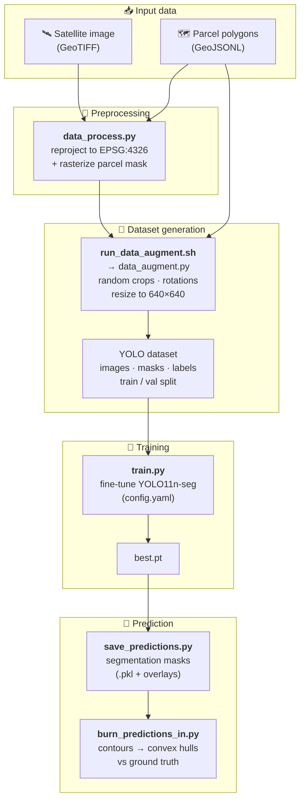
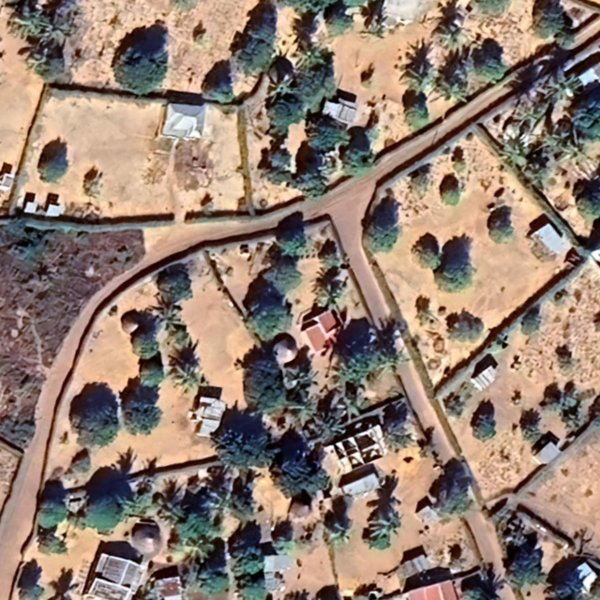
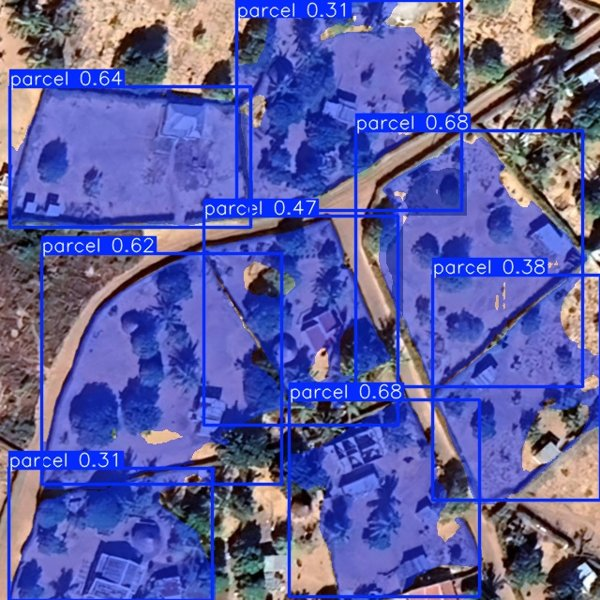
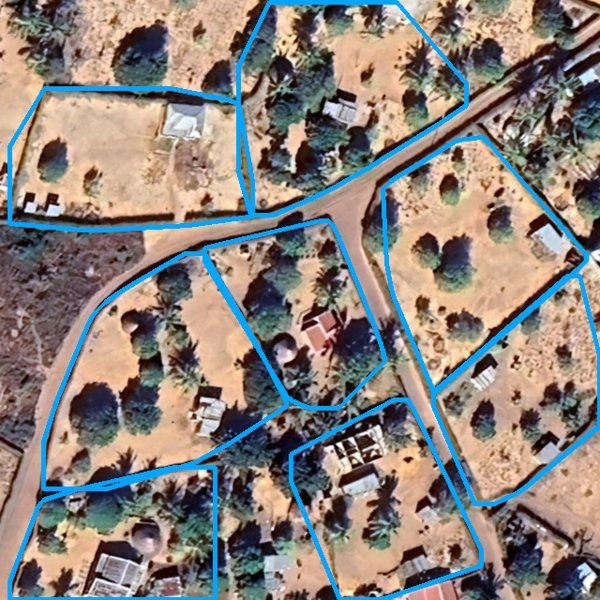
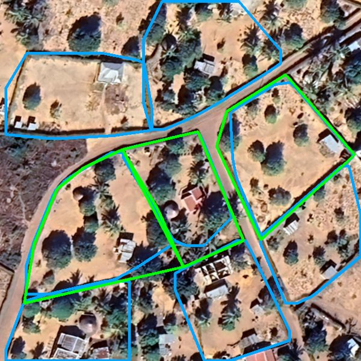

# GIZ: Parcelation

Authors: Jinsguy, Joelle, Andrea and Michal from Hack4Good 2024 @ ETH.

Automatic land-parcel delineation from satellite imagery for a cadastral system in **Vilankulos, Mozambique**, built with GIZ. A YOLO segmentation model is fine-tuned on existing parcel polygons, so there is no extra annotation cost, and it runs on a personal laptop.

## Pipeline



## Results

| Input tile | YOLO masks | Predicted parcels | Prediction vs ground truth |
|:---:|:---:|:---:|:---:|
|  |  |  |  |

In the last image, blue outlines are predictions and green outlines are ground-truth parcels.

## Roadmap

- ✅ Feasibility check
- 1️⃣ Evaluation & tuning
- 2️⃣ Package and deploy
- 3️⃣ Advance the solution

## Set up the environment

1. Install Python 3.11, Conda and Git, then clone the repository.

```shell
git clone https://github.com/<your-username>/giz-parcelation.git
cd giz-parcelation
```

2. Create the conda environment

```shell
conda create --name giz python=3.11
conda activate giz
```

3. Install the necessary packages

```shell
pip install -r requirements.txt
```

4. Download the data into the `data` directory.

```shell
mkdir data
wget -O data/vilankulo_all.geojsonl.json https://polybox.ethz.ch/index.php/s/8vqML2eB6ST3GNO/download
wget -O data/img_aoi.tif https://polybox.ethz.ch/index.php/s/R9QYE9ET7LBuyrp/download
```

> Data, model weights (`*.pt`) and training outputs (`runs/`) are not tracked in Git — see `.gitignore`.

## Training

1. Preprocess the dataset

```shell
python data_process.py --geotiff input/rasterized_output.tif --geojson input/vilankulo_all.geojsonl.json
```

2. Augment the data and transform it into YOLO format

```shell
sh run_data_augment.sh
```

3. Fine-tune the YOLO model (set the dataset path in `config.yaml` first)

```shell
python train.py
```

## Predictions & generation of polygons

1. Run the trained model and save prediction masks on the images, as well as the arrays.

```shell
python3 save_predictions.py
```

2. Burn in the contours from the mask and the ground truth.

```shell
python3 burn_predictions_in.py
```
